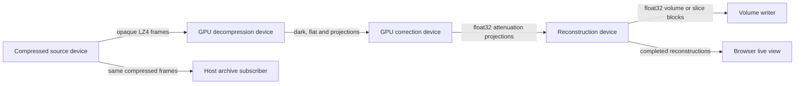

# GPU tomography pipeline

An end-to-end detector processing example built with the installed
[tango-ucx](https://github.com/srwohl/tango-ucx) package. Four Tango device server
processes carry compressed scans through GPU decompression, dark/flat correction and
reconstruction. Independent subscribers archive the compressed input, write float32
volumes and display completed reconstructions in a browser.

Use it to test a processing pipeline with bounded transport memory, concurrent archival,
CPU/GPU reconstruction and a live view. It supports a generated phantom or a local HDF5
parallel-beam scan, one-shot execution or continuous replay, and configurable GPU placement
and UCX policy.



Each arrow is a UCX subscription discovered through Tango. Processing, archival and
volume writing use every delivery and apply pressure when receive storage fills.
The archive stores the original received bytes, lengths, records, projection angles,
scan identity and calibration identity without decoding or recompressing them.

## Build and run

Use Linux, Pixi and an NVIDIA GPU with a CUDA 12.9 compatible driver. From the examples
project root, select the library checkout and run:

```sh
TANGO_UCX_SOURCE=/path/to/tango-ucx ./build_local.sh
pixi run tomography --output results/tomography
```

The first command installs the library into `stage/`. The tomography task builds the
pipeline device against that installation. The examples' Pixi environment provides CuPy,
nvCOMP, CUDA ASTRA, TomoPy, LZ4 and h5py; its Python version must match the installed extension.

The default run uses 96 projections, an 8 × 64 × 64 volume and 40 SIRT iterations.
The launcher starts four local servers, joins every subscription before acquisition,
starts downstream stages first, drains the pipeline and verifies the results.
`--output` must name a new directory; omitting it uses temporary files removed after verification.

| Output | Contents |
|---|---|
| `volume.npy` | Latest float32 reconstructed volume |
| `reconstruction.png` | Display image of the reconstruction |
| `summary.json` | Verification results, workload, throughput and pressure |
| `archive/` | `payloads.bin`, `records.jsonl` and the stream description |
| Server logs | Output from the four device servers |
| `volume-settings.jsonl` | Settings and revision used for each written scan |
| `devices.json` | Tango addresses, process IDs and GPU placement |

For all launch options, use `pixi run python tomography/demo.py --help`.

## Continuous replay and live view

```sh
pixi run tomography-live --output results/tomography-live
```

The launcher repeats the prepared scan without restarting the device servers or
subscriptions and opens `http://127.0.0.1:8765`. Live runs default to CPU GridRec.
Each replay gets new scan/calibration IDs; publisher frame indices keep increasing.
GPU rings, source slots, calibration maps and scan buffers are reused.

Rotate the 3D volume by dragging, scroll to zoom, or choose **View → Slice** for axial,
coronal and sagittal sections. The time slider and playback controls browse completed
scans; **Follow live** returns to the newest. **Appearance → Interior** emphasizes faint
phantom structures; **Full density** shows the full intensity range. Display controls
leave scientific output unchanged.

The viewer uses WebGPU when available and falls back to WebGL 2, including after
WebGPU device loss. The active backend is shown beside the volume dimensions.
Display history is bounded to 32 volumes / 64 MiB by default; use
`--view-history-volumes` and `--view-history-mib` to change it. Each display volume
must fit the byte limit. The browser cache is separately bounded to 8 volumes / 32 MiB.

In volume output mode, the viewer uses latest delivery and can skip volumes without
applying pressure. Block output mode requires every block to assemble a complete volume;
its display worker can skip completed snapshots, but a slow block receiver can apply pressure.
The writer and input archive preserve every frame in both modes.

Press Ctrl-C or choose **Stop acquisition** to finish the current scan, drain and verify
outputs, and stop the child processes. `volume.npy` is replaced atomically after each
completed volume. The archive grows on disk and is verified one frame at a time.
The final summary reports completed scans; live runs also write `status.json`.

| Option | Effect |
|---|---|
| `--no-browser` | Print the URL without opening a browser |
| `--view-port 0` | Choose a free local port |
| `--scan-period SECONDS` | Minimum time between source scan starts; default 1 second |
| `--scans N --live` | Run a finite sequence with the viewer |
| `--loop --live` | Continuous replay, equivalent to `tomography-live` |

```sh
pixi run tomography --scans 3 --scan-period 0 --live --no-browser --view-port 0 \
  --output results/tomography-three-scans
```

The HTTP listener binds to localhost. Phantom display uses a fixed 0–0.01 window;
HDF5 display uses the initial reference's 99.5th percentile, with a minimum of `1e-6`.
`--display-max` overrides either. Display bytes are quantized to uint8; `volume.npy`
retains float32 values, including negatives. Scaling can saturate the display window.

## Select reconstruction

| `--algorithm` | Backend | Use |
|---|---|---|
| `gridrec` | TomoPy on CPU | Padded Fourier gridding, with `--recon-threads` (default 4) |
| `fbp` | ASTRA `FBP_CUDA` on GPU | Slice-wise filtered backprojection with GPU-linked arrays |
| `sirt` | ASTRA GPU projectors and CuPy | Iterative reconstruction, with `--iterations` (default 40) |

Ordinary runs default to SIRT; live runs default to GridRec. Analytic methods accept
`--recon-filter ram-lak|shepp-logan|hann|parzen`. SIRT ignores that filter.

```sh
pixi run tomography-live --algorithm fbp --recon-filter hann --filter-cutoff 0.7
pixi run tomography --algorithm sirt --iterations 80 --relaxation 0.5 --gaussian-fwhm 1
pixi run tomography-live --algorithm gridrec --center 32 --recon-filter parzen
```

In **Reconstruction settings**, edit the algorithm and its knobs and choose **Apply to
next scan**. The current scan finishes with its active settings; the latest validated
configuration takes effect at the next scan boundary. Geometry stays fixed, subscriptions
stay running, and buffered volumes keep their original settings revision.

| Flag | Method | Meaning / default |
|---|---|---|
| `--iterations N` | SIRT | Positive update count; 40 |
| `--relaxation VALUE` | SIRT | Update multiplier in (0, 2); 1 |
| `--min-constraint VALUE` | SIRT | Iteration lower bound; 0, or `none` |
| `--max-constraint VALUE` | SIRT | Iteration upper bound; `none` |
| `--filter-cutoff VALUE` | FBP Hann / Shepp–Logan | ASTRA `FilterD` in (0, 1]; backend default 1 |
| `--center VALUE` | GridRec | Rotation axis in original detector pixels; columns / 2 |
| `--recon-threads N` | GridRec | CPU threads; 4 |
| `--slices-per-block N` | All | Slices per backend call; 0 means all slices |
| `--gaussian-fwhm VALUE` | All | Isotropic 3D Gaussian width in voxels; 0 disables |
| `--scale-factor VALUE` | All | Positive multiplier after smoothing; 1 |

Center correction is available for GridRec only. Gaussian smoothing uses reflect boundaries
and sigma = FWHM / sqrt(8 ln 2), then scaling runs; SIRT bounds apply before postprocessing.
Physical/anisotropic voxel spacing and phase retrieval require separate processing.

The Tango reconstruction device also provides `GetReconstruction`,
`ConfigureReconstruction` and `ReconstructionForScan`. Configuration updates replace the
complete settings; omitted knobs take defaults. Per-volume records contain the settings
used during live acquisition, while the transport description retains launch settings.

## Replay an HDF5 scan

From the examples project root:

```sh
pixi run tomography --hdf5 /path/to/scan.h5 --sino 0:2 --algorithm gridrec \
  --output results/measured-scan
```

The default input layout is Data Exchange:

| Dataset | Shape / contents |
|---|---|
| `/exchange/data` | `(projections, rows, columns)`, raw detector counts |
| `/exchange/data_white` | Flat-image stack or one `(rows, columns)` image |
| `/exchange/data_dark` | Dark-image stack or one `(rows, columns)` image |
| `/exchange/theta` | One angle per projection |

Use `--data-path`, `--flat-path`, `--dark-path` and `--theta-path` for other locations.
`--sino START:STOP[:STEP]` selects rows; `--proj START:STOP[:STEP]` selects projections
and matching angles. Bounds are zero-based and stop-exclusive; step must be positive.
File dimensions replace `--pixels`, `--slices` and `--angles`.

Angle units come from theta's `units` attribute, defaulting to degrees. Override with
`--theta-units degrees|radians`. If the default theta dataset is absent, equally spaced
angles from 0 through 180 degrees are generated before projection selection. A missing
custom theta path is an error. Acquisition rotation metadata is not read.

Inputs must be finite, nonnegative raw counts representable in float32. Fractional counts
are supported. Calibration stacks are averaged in float64; flat must exceed dark at every
selected pixel after conversion. Integral inputs of at most 16 bits with integral calibration
in `[0, 65535]` use uint16; otherwise the detector stream uses float32. Conversion of float64
or wider integers can lose precision. Corrected projections and output remain float32.

Each projection is read and compressed as a raw LZ4 block. HDF5 compression is not forwarded.
Correction computes `-log(clip((raw-dark)/(flat-dark), 1e-6, 1))`; normalized transmission or
attenuation arrays need preprocessing. The input has one dark and one flat image per scan.
Calibration drift, per-projection flats, invalid-pixel masks and NeXus image-key layouts
need preprocessing too. Selected scan data and reference volumes must fit available memory.
Source selections, angle units and dtype are saved in `scan.json` and workload metadata.
For pip-managed environments, add [requirements-hdf5.txt](requirements-hdf5.txt).

## GPU placement, transport and batching

The launcher starts all four servers on one machine. `--gpu N` chooses the preparation
GPU and default stage GPU; `--decompress-gpu`, `--correct-gpu` and `--reconstruct-gpu`
override individual stages. IDs are logical indices within `CUDA_VISIBLE_DEVICES`.

| `--network` (`--profile` alias) | UCX policy |
|---|---|
| `tcp` (default) | `tcp,cuda_copy,self`; local loopback unless an interface is configured |
| `auto` | `all`; UCX selects CUDA IPC or another available transport |
| `rdma` | `rc,cuda`; TCP fallback disabled |

`--net-devices` selects an interface or HCA and port; omission preserves existing UCX
selection. UCX settings such as `UCX_PROTO_INFO=y` are inherited by all child processes.

```sh
pixi run tomography-live --network auto --algorithm sirt \
  --decompress-gpu 0 --correct-gpu 0 --reconstruct-gpu 1 --output results/live-two-gpus
UCX_PROTO_INFO=y pixi run tomography-live --network rdma --net-devices mlx5_0:1 \
  --algorithm sirt --output results/live-rdma
```

Processing reads borrowed GPU receive buffers and writes directly into GPU publisher slots.
CUDA IPC/peer access or GPUDirect RDMA can avoid host staging with suitable hardware and
software. TCP can stage through host memory; an RDMA transport name alone does not establish
GPUDirect. Inspect UCX protocol output and CUDA traces on the deployment. GridRec uses CPU
reconstruction; archive, writer and viewer receive host data. For inter-node launches, see
[the separate-node examples](../README.md#run-on-separate-nodes).

The demo defaults to `--transport-batch 16 --processing-batch 16 --processing-mode batched`.
Decompression uses nvCOMP list decoding. Dark/flat correction launches one kernel for a
group of projections, writing directly into separate publisher slots without payload staging.
GPU reconstruction input is packed into the retained sinogram with one kernel per group;
host sinograms retain their bounded pinned transfers. Reconstruction runs after the scan
is complete, using the algorithm and `--slices-per-block` settings described above.

`--transport-batch` limits frames per receive batch. `--processing-batch` is the shared
upper limit for a processing group, capped by the transport batch. Each stage can override
the shared size and mode with `--decompress-batch` / `--decompress-mode`,
`--correct-batch` / `--correct-mode`, and `--reconstruct-batch` / `--reconstruct-mode`.
Batches can be shorter at scan boundaries, calibration transitions or when the receive
wait expires. Dark and flat updates remain ordered before their matching projections.
For example:

```sh
pixi run tomography --decompress-batch 16 --correct-batch 8 --reconstruct-batch 16 \
  --algorithm fbp --slices-per-block 4 --budget 1048576
pixi run tomography --processing-mode scalar --transport-batch 1
```

Stage reports include processing calls, batched calls and frames processed in groups,
so a requested batch size can be compared with the groups actually received.

For performance comparisons, verification, saving and decompression can be disabled independently:

```sh
pixi run tomography --algorithm fbp --scan-period 0 --scans 100 \
  --no-verify --no-save --no-decompress
```

`--no-verify` skips independent reconstruction, numeric comparison and phantom-error
calculation. `--no-save` removes the detector archive subscriber, per-volume files and
final plots; prepared input, logs and small run summaries remain. `--no-decompress`
publishes original uint16/float32 detector frames straight from the source to correction,
removing the decompression server and its transport link. All three default to enabled,
and the viewer exposes the same choices when restarting acquisition. Frame counts,
scan identity and transport failures are checked in every mode.

Each completed-volume log entry has an acquisition-relative timestamp. Use intervals
after warm-up volumes to compare steady processing; `acquisition_seconds` stops at the
last volume, while `elapsed_seconds` also includes the final archive drain.

The viewer's **Acquisition settings** can change transport, GPUs, shared and per-stage batching, memory modes,
budgets, pacing and synthetic dimensions through **Restart after current scan**.
**Size buffers for this scan** prepares budget values for review. Restart drains and
verifies the current run, retains its output and creates `run-0001`, etc. below it.
The viewer URL stays the same and history restarts. HDF5 dimensions stay fixed to the file.

## Bound reconstruction memory

The default retains the full corrected sinogram on GPU and publishes one full volume per
scan. Positive `--slices-per-block` reduces backend working memory; each block still contains
all angles. The complete sinogram and output volume remain allocated, and reconstruction
starts after all angles arrive. The worker processes blocks sequentially and handles a
short final block. SIRT reuses regular/tail scratch; CuPy may cache released allocations.

Use host sinogram retention to remove the full GPU sinogram allocation:

```sh
pixi run tomography-live --algorithm sirt --sinogram-memory host \
  --slices-per-block 3 --host-buffer-mib 1024 --pinned-buffer-mib 128
```

This retains one scan in ordinary host RAM. Two pinned frame slots download projections;
two pinned input slots and two GPU block buffers prefetch GPU reconstruction input.
Events protect staging buffers before reuse. Host-backed GridRec reads host sinogram blocks
and uses two pinned output slots for uploads. CPU packing/copying is part of this path;
ASTRA synchronization can limit transfer/compute overlap.

For float32 data, with rows `R`, angles `A`, columns `C` and effective block depth `B`:

| Allocation | Bytes |
|---|---:|
| Retained host sinogram | `4 × R × A × C` |
| Pinned staging, SIRT / FBP | `2 × (4 × R × C + 4 × B × A × C)` |
| Pinned staging, GridRec | `2 × (4 × R × C + 4 × B × C × C)` |
| GPU input blocks, host-backed SIRT / FBP | `2 × 4 × B × A × C` |
| One full-volume GPU output payload | `4 × R × C × C` |

`--host-buffer-mib` (default 1024) bounds retained sinogram storage;
`--pinned-buffer-mib` (default 128) bounds transfer staging. Budgets are checked before
allocation and live settings updates. A block depth of 0 means all rows, so use a positive
depth for large scans. Algorithm/block changes can exceed staging budgets and be rejected.

### Publish bounded slice blocks

To remove full-volume GPU publisher slots too:

```sh
pixi run tomography-live --algorithm sirt --sinogram-memory host \
  --output-mode blocks --slices-per-block 3 --output-host-mib 1024
```

The worker reconstructs into library-owned GPU block slots. Each publication carries
slice start/count, scan/calibration IDs and settings revision. Launch block depth fixes
capacity; live depth can decrease or return to that capacity. Zero and larger layouts
are rejected. Short blocks zero unused rows, and the full capacity is transferred.

The writer and viewer independently receive every block and assemble host volumes,
checking sequence, coverage, overlap, identity and settings revision. Missing blocks at
End fail. Gaussian smoothing and scaling run on the assembled host volume, preserving
cross-block boundaries. The viewer drains blocks separately from display and keeps one
pending completed snapshot, which newer complete volumes can replace.

With capacity `Bcap` and payload `P = 4 × Bcap × C × C`:

| Allocation / capacity | Bound |
|---|---:|
| One GPU publisher payload | `P` |
| Publisher budget including bookkeeping | `max(--budget, 8 × P + 192 KiB)` |
| GPU publisher payload storage | At most `min(1024, floor(publisher_budget / P)) × P` |
| Each host receive-ring budget | `max(--budget, 4 × P + 128 KiB)` |
| Writer retained float output | `4 × R × C × C` |
| Viewer assembly and display snapshots | At most `3 × 4 × R × C × C` |

`--output-host-mib` (default 1024) bounds retained float output per consumer; the block
viewer needs three volumes. Quantized history has its own limit. `buffering.memory_plan`
reports layout and budgets. These limits cover owned buffers; transport rings, backend
scratch, allocator caches, postprocessing, scan preparation and reference verification
need additional memory. Writer and viewer duplicate output transfer traffic.
Blocks can represent logical volumes above the transport's 2 GiB frame limit when each
block fits, subject to host assembly, reference and viewer capacities.

## Workloads and checks

| Preset | Volume | Projections | Receive budget | Scan pause |
|---|---|---:|---|---|
| Default | 8 × 64 × 64 | 96 | 256 KiB | 1 second |
| `--stress` | 32 × 128 × 128 | 360 | 8 MiB | None |
| `--gpu-stress` | 128 × 256 × 256 | 720 | 8 MiB | None |

Presets are mutually exclusive; explicit dimensions and timing override them.
Algorithm selection is independent. Each scan also contains one dark and one flat frame.

```sh
pixi run tomography-live --stress --output results/tomography-stress
pixi run tomography-live --gpu-stress --algorithm sirt --output results/tomography-gpu-stress
pixi run tomography --budget 131072 --transport-batch 1 --correction-delay-ms 3 --output results/tomography-pressure
pixi run test-pipeline
pixi run python -m unittest discover -s tomography -p 'test_*.py'
```

The demo reopens the archive and checks exact compressed bytes, indices and records.
It checks stage counts, stream failures, quarantined bytes and finite output, and compares
reconstruction with an independently corrected reference. SIRT uses ASTRA's built-in
reference; FBP uses host-backed ASTRA objects; GridRec uses TomoPy on independent input.
Synthetic runs also compare against the known phantom; HDF5 phantom errors are `null`.
`--max-phantom-error` sets the initial relative-L2 limit (default 0.65). After live tuning,
phantom error is diagnostic while finite-value/reference checks remain mandatory.

CPU tests cover input, controls, memory budgets, block coverage and backend behavior.
Set `TOMOGRAPHY_TEST_GPU=1` to include actual GPU reconstruction and buffering checks.
The optional browser test requires `puppeteer-core` and `TOMOGRAPHY_CHROME`; from this directory,
run `node test_volume_browser.cjs webgpu` and `node test_volume_browser.cjs fallback`.

Throughput reports mean application rates during acquisition, including pipeline fill,
processing, archival, verification, output and drain. Preparation and startup are excluded.
Stages count compressed, detector, corrected and reconstructed payload bytes respectively.
Use the [benchmark project](https://github.com/srwohl/tango-ucx-benchmarks) to isolate transport costs.

GPU ownership uses explicit CUDA streams and completion events before receive credit or
source-slot reuse. Deliberate GPU copies align compressed input, retain calibration and
assemble sinograms. ASTRA owns separate streams, so CuPy handoffs synchronize; FBP also uses
backend GPU scratch/copies. Protocol names and correctness tests alone cannot prove absence
of host staging or transfer/compute overlap; validate those with deployment traces.
